# 帕琴律动 · Paqin Rhythm

面向帕金森康复场景的 Web 平台，包含患者档案、视频辅助评估、钢琴节奏与芭蕾动作训练，以及训练日历、趋势分析和报告。工程名为 `PD-Rehab-Web`。

[在线访问](https://ccqspace.site/pd-rehab/) · [运行与使用说明](运行与使用说明.md) · [中英文切换验收](docs/i18n-local-only-20261022/README.md)

当前支持简体中文与 English。登录页、主界面右上角和训练任务界面提供语言切换，刷新后保留选择。切换保留患者、表单草稿、图表筛选和当前训练状态；患者姓名、医生备注、原始记录不自动翻译。

本系统用于辅助评估、训练记录与科研展示，不能替代专业诊断或标准临床量表。模型与指标按实际可用能力展示，不能据此宣称临床疗效。

## 界面预览

以下为 2026-10-22 当前源码的浏览器截图，使用独立本地测试环境和测试记录，不含线上真实患者资料。

### 中文登录与工作台

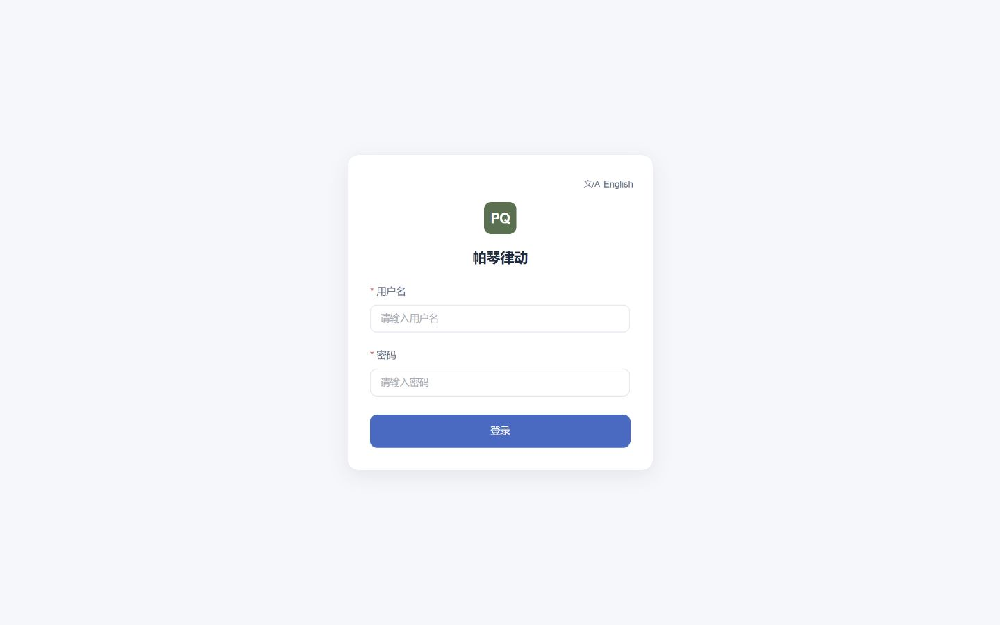

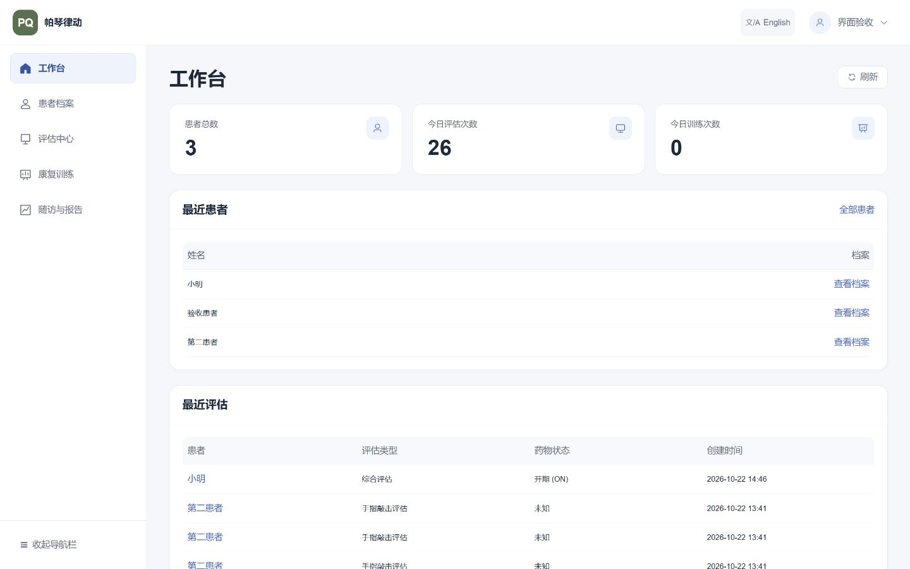

### 患者档案与评估中心

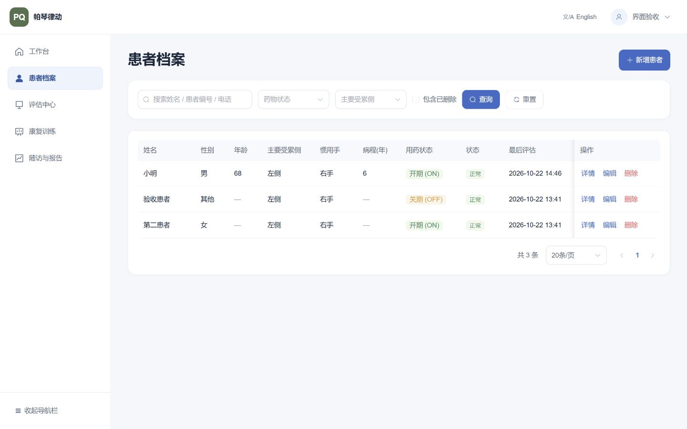

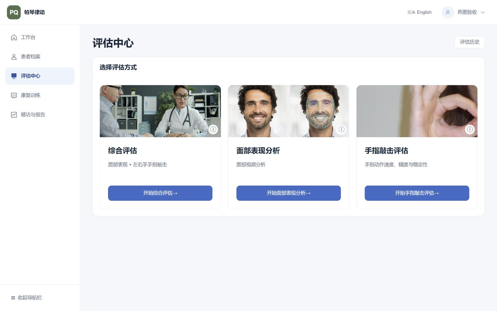

### 钢琴与芭蕾训练

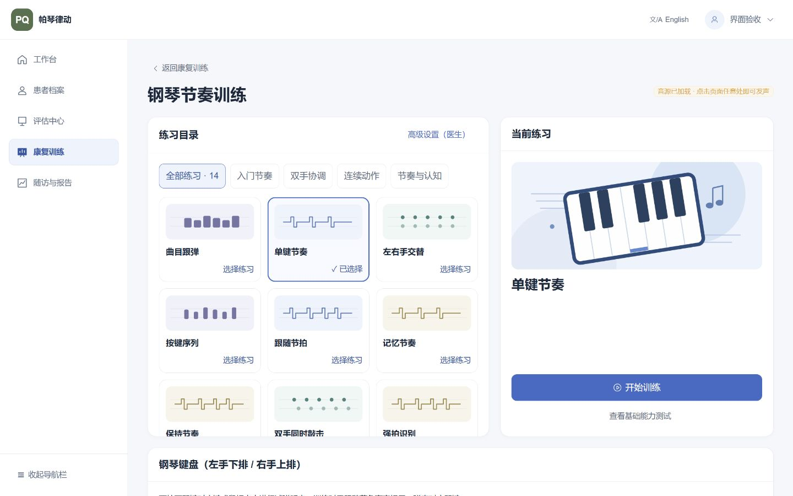

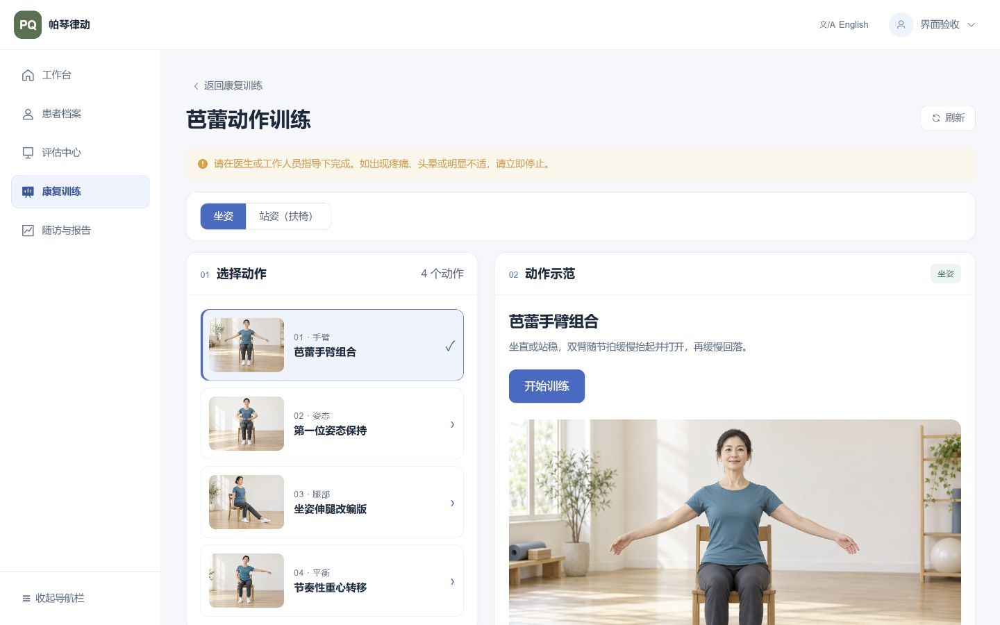

### 日历与趋势分析

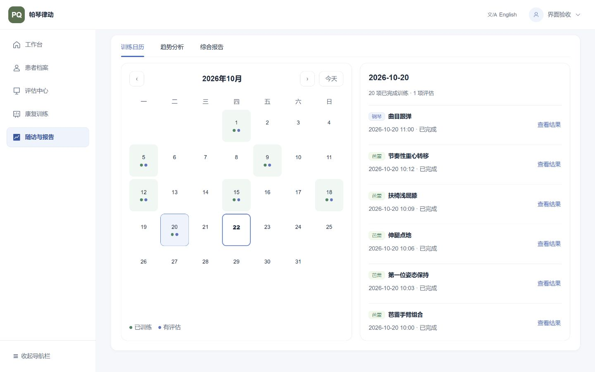

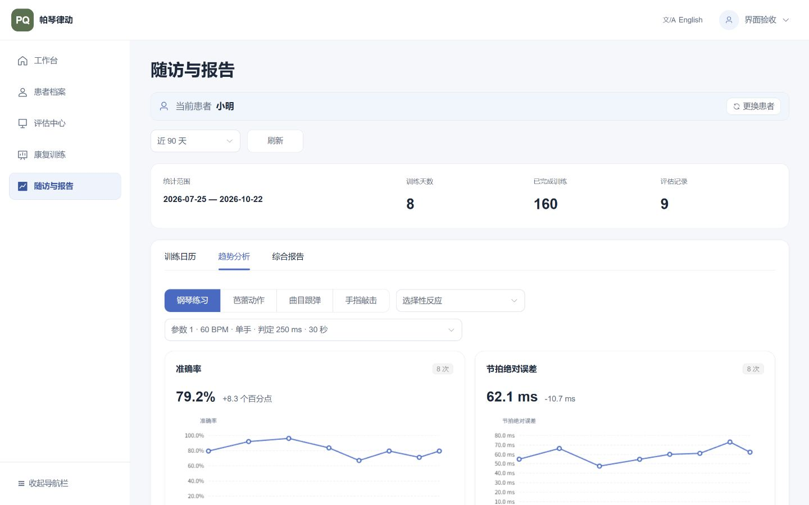

### English 与移动界面

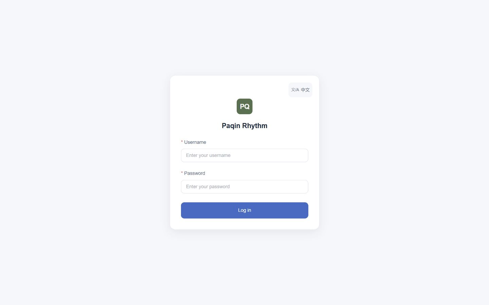

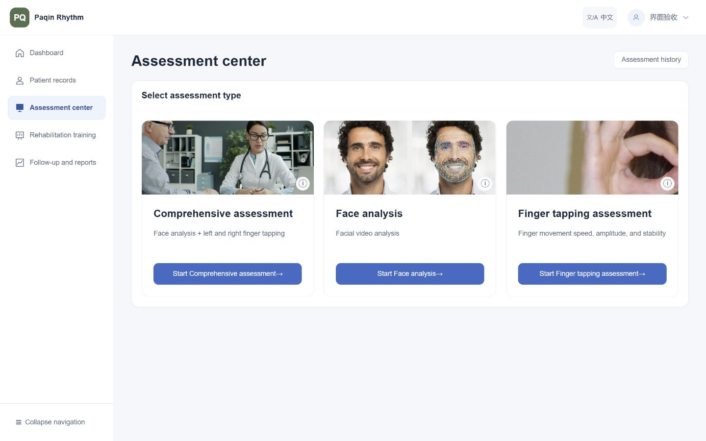

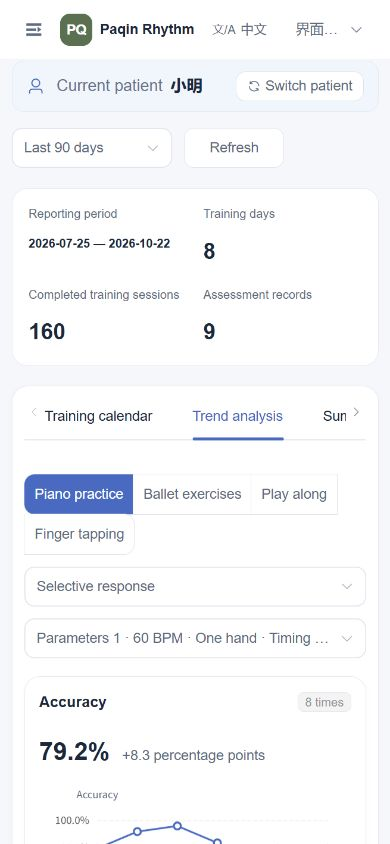

## 当前功能

| 模块 | 内容 |
| --- | --- |
| 工作台 | 患者、评估与训练概览，近期活动与功能入口 |
| 患者档案 | 搜索、筛选、新增、编辑、详情；后端自动分配患者编号 |
| 评估中心 | 综合评估、面部表现分析、左右手手指敲击；历史结果查看与未完成评估删除 |
| 钢琴训练 | 14 个练习入口、试听、倒计时、按键提示、事件记录、指标与结果查看 |
| 曲目跟弹 | 分段示范、模仿和练习，琴键字母提示，暂停与结果回顾 |
| 芭蕾训练 | 5 类动作、适用的坐姿或站姿扶椅方式、动作图示、视频采集与姿态指标 |
| 随访与报告 | 按日查看评估和训练；按练习、参数与算法版本分组的趋势图；综合报告 |
| 中英文 | 导航、表单、日历、图表标签、操作提示、控件与已知错误提示切换 |

评估与训练启动时确认患者。未选择患者时可以浏览、试听和选择练习；仅浏览或取消倒计时不应创建训练记录。进行中任务的继续与清除受服务端校验约束；进行中和中断记录不作为日历中的已完成活动。

### 钢琴练习目录

| 项目 / 内部标识 | 主要任务 |
| --- | --- |
| 曲目跟弹 `GUIDED_SONG` | 观看分段示范，按琴键字母模仿和跟弹 |
| 单键节奏 `SINGLE_KEY_RHYTHM` | 根据提示敲击单键；`SFT_CUE_SYNC` 为其听提示按键变体，不重复占用目录入口 |
| 左右手交替 `ALTERNATING_HANDS` | 交替完成左右任务映射 |
| 按键序列 `MAPPED_SEQUENCE` | 按指定顺序完成多键序列 |
| 跟随节拍 `FOLLOW_THE_BEAT` | 将按键时机与目标节拍对齐 |
| 记忆节奏 `MEMORY_RHYTHM` | 记忆提示后复现节奏 |
| 保持节奏 `CFT_RHYTHM_HOLD` | 提示减少后保持稳定节拍 |
| 双手同时敲击 `BIMANUAL_SYNC` | 在同一目标时刻完成双键任务 |
| 强拍识别 `ACCENT_GROUPING` | 根据强弱节拍提示识别分组，不测量按压力度 |
| 节奏变速 `TEMPO_RAMP` | 随目标速度变化调整敲击节奏 |
| 长短音控制 `HOLD_RELEASE` | 控制按下、保持与释放时机 |
| 双手错位节奏 `BIMANUAL_OFFSET` | 根据不同时间偏移完成双手任务 |
| 反向序列 `REVERSE_SEQUENCE` | 逆序复现给定按键序列 |
| 选择性反应 `GO_NO_GO` | 对目标提示响应，对抑制提示保持不按键 |

基础能力测试独立于这 14 个练习，用于个人基线。只有满足真实输入与质量要求的 `HUMAN_KEYBOARD` 校准才参与有效基线；查询层使用 `is_active=True`，不能把程序生成事件得到的校准作为真实个人基线。

钢琴可输出准确率、节拍误差、反应延迟、漏击等适用指标；长短音、变速、同步和抑制任务还有专用指标。普通键盘和触屏不能可靠测量真实力度，也不能验证实际使用了哪根生理手指。

### 芭蕾动作

| 内部标识 | 动作 |
| --- | --- |
| `BALLET_PORT_DE_BRAS` | 芭蕾手臂组合 |
| `BALLET_FIRST_POSITION` | 第一位姿态保持 |
| `BALLET_TENDU` | 伸腿点地；坐姿显示对应改编动作 |
| `BALLET_DEMI_PLIE` | 扶椅浅屈膝 |
| `BALLET_WEIGHT_SHIFT` | 节奏性重心转移 |

姿态分析使用可见关键点、关节角度、对称性与稳定性等实际计算结果，受拍摄质量与动作版本约束；图片用于动作说明，不等同于算法测量证据。

### 视频模型与分析边界

- 手指敲击与姿态分析依赖各自的模型资源和视频质量。缺少模型、有效帧或周期不足时返回相应状态。
- MicroFlow-DA 已有后端适配、模型状态检查与权重安置流程，但现有源码的时序分支存在 `TEMPORAL_BRANCH_DISCONNECTED` 问题，不能把“存在权重”当成真实推理已验收。当前状态以 `/api/system/models` 返回为准。
- PyTorch、dlib、模型权重、患者数据库和上传视频不随仓库提供。面部模型的识别类别、适配与依赖边界见 [MicroFlow 接入说明](docs/microflow_integration.md)。
- 随访趋势只应在相同练习、相同关键参数和可比版本之间比较；测试记录的趋势不代表患者疗效。

## 安装与运行

完整安装、登录、设备要求和有效测试流程见 **[运行与使用说明](运行与使用说明.md)**。建议 Python 3.11、Node.js 22 LTS（至少 22.12）。摄像头使用 HTTPS 或 localhost 安全上下文，钢琴音频需要用户操作后解锁。

```powershell
git clone https://github.com/WuChangqing1/PD-Rehab-Web.git
cd PD-Rehab-Web
py -3.11 -m venv .venv
.\.venv\Scripts\Activate.ps1
python -m pip install -r backend/requirements.txt
Copy-Item .env.example .env
```

首次安装时编辑根目录 `.env`，生成独立的 `JWT_SECRET`，设置本地 `BOOTSTRAP_ADMIN_USERNAME`、`BOOTSTRAP_ADMIN_PASSWORD` 和 CORS。已有 `.env` 请保留，不重复覆盖。初始账号只在数据库没有工作人员时创建；修改初始化配置不会重置已有密码。

后端终端：

```powershell
cd backend
python -m alembic upgrade head
python -m uvicorn app.main:app --host 127.0.0.1 --port 8000 --reload
```

前端终端，从项目根目录执行：

```powershell
npm --prefix frontend ci
npm --prefix frontend run dev -- --host 127.0.0.1 --port 5173 --strictPort
```

访问 `http://127.0.0.1:5173`。线上账号由管理员单独提供，仓库不提供线上密码或患者数据库。模型资源安装和自建服务器配置见使用说明；已有数据库升级前先做可恢复备份。

## 构建与测试

2026-10-22 发布验收：前端测试 **304 项** 通过；后端 **481 passed、1 skipped**。后端跳过项需要当前测试环境未安装的 PyTorch；这不构成面部模型推理通过的证据。根路径与 `/pd-rehab/` 两种前端构建均通过。

```powershell
npm --prefix frontend run test
npm --prefix frontend run build
$env:VITE_BASE = '/pd-rehab/'
npm --prefix frontend run build -- --outDir dist-under-path
Remove-Item Env:VITE_BASE
```

后端测试在独立测试数据库和输出目录中执行：

```powershell
cd backend
python -m pytest tests -o addopts='' -q -rs
```

本轮浏览器检查覆盖桌面 1440、平板 768、手机 390 像素视口，语言刷新记忆、表单草稿保护、日历与趋势切换，以及暂停状态下的曲目跟弹中英往返。响应式视口检查不能替代真实触控测试：`hover: none` 相关分支需真实触屏设备或 DevTools `setTouchEmulationEnabled`，发布到具体设备时应另行验收。

## 主要路由

```text
/login                              登录
/dashboard                          工作台
/patients                           患者档案
/patients/:id                       患者资料
/assessment                         评估中心
/assessment/sessions/:sessionId      综合评估
/assessment/sessions/:sessionId/results  评估结果
/assessment/micro-expression         面部表现分析
/assessment/finger-tapping           手指敲击评估
/training                           康复训练
/training/piano                     钢琴节奏训练
/training/piano/guided-song          曲目跟弹
/training/movement                  芭蕾动作训练
/follow-up                          随访与报告
/system/model-status                系统状态
```

系统状态页无导航入口；功能测试页为隐藏占位，不属于已完成的评估项目。子路径部署时路由位于 `/pd-rehab/` 下。

## 工程与文档

```text
frontend/        Vue 3 + TypeScript + Vite + Element Plus + ECharts
  src/i18n/      中英文状态、词库与图表标签
  src/piano/     节奏任务、事件处理与曲目跟弹
  src/pages/     患者、评估、训练与随访页面
  tests/         前端规则与交互回归
backend/         FastAPI + SQLAlchemy + Alembic
  app/ml/        手部、姿态、面部模型适配
  tests/         API、指标、生命周期与存储测试
docs/            设计、指标、验收与部署说明
```

- [指标定义](docs/metric_definitions.md)
- [钢琴训练设计](docs/piano_training_plan.md)
- [曲目跟弹升级说明](docs/guided_song_upgrade_report.md)
- [芭蕾动作依据](docs/ballet_training_rationale.md)
- [患者编号分配](docs/patient_number_allocation.md)
- [中英文验收与浏览器截图](docs/i18n-local-only-20261022/README.md)

图片来源信息保留在素材目录与图片来源入口。不要将本地 `.env`、权重、数据库、视频或含真实患者资料的截图提交到公开仓库。