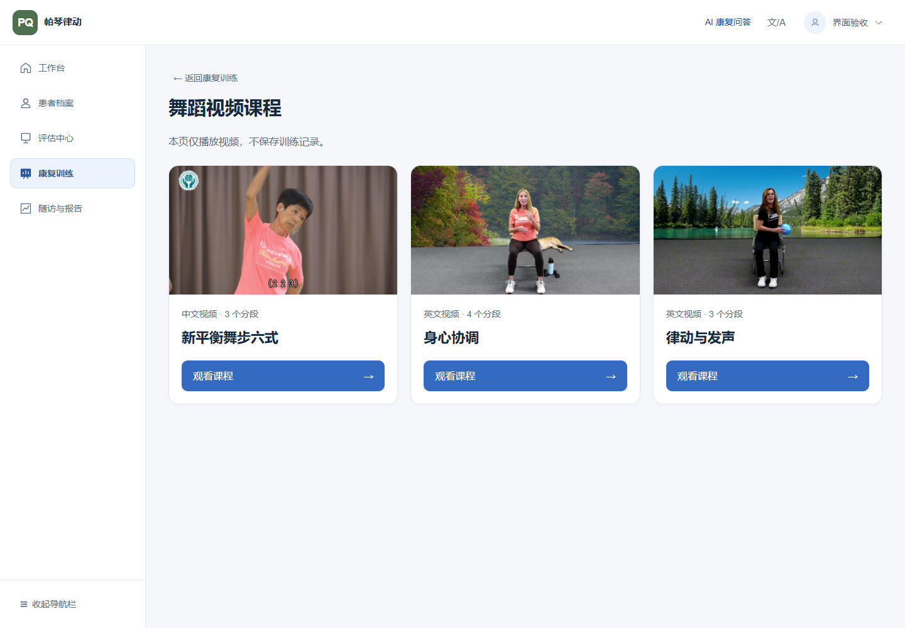
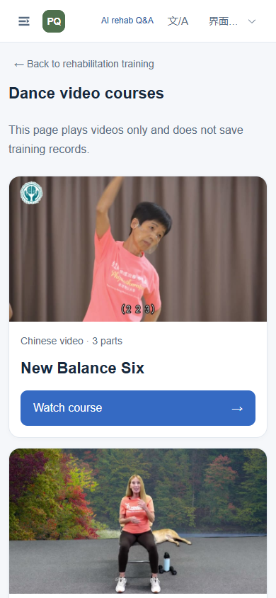

# 三门舞蹈课程与短信登录交付（2026-11-13）

## 已发布内容

Web 与 App 都显示三门课程：新平衡舞步六式（中文，3段）、Brain and Body（英文，4段）、Move and Shout（英文，3段）。中英文界面均可自由选择全部课程。Fandango 已移出当前 App 目录和安装包，原有历史记录仍可读取。

- [Web舞蹈课程](https://ccqspace.site/pd-rehab/training/dance)：工作人员登录后，康复训练→舞蹈视频课程；原“动作训练”姿态分析入口保留。该视频页面仅观看，不新增患者训练记录或伪造姿态指标。
- [App0.1.68 ARM64联调安装包](https://ccqspace.site/pd-rehab/assets/app-releases/0.1.68/PianoForParkinson-0.1.68-media-sms-QA-arm64.apk)：124,882,291字节，约119.10 MiB，较上一联调包减少73.384%。独立 `.validation` 包名，不覆盖另一证书签名的正式App。
- [APK校验文件](https://ccqspace.site/pd-rehab/assets/app-releases/0.1.68/SHA256SUMS.txt) · [发布元数据](https://ccqspace.site/pd-rehab/assets/app-releases/0.1.68/release.json) · [10段资源清单](https://ccqspace.site/pd-rehab/assets/dance/v2/resources-v2.json)。

APK SHA-256：`7346f873278f74bdf9d06bf502ae9058de1d5c4436bf5afceaaf3d31694f8b25`。APK内部未打包任何MP4/WebM；原生播放器按实际读取缓存，完整缓存仍须本地SHA校验，旧中文v1身份保持不变。新增视频7段复用现有静态路由，未修改旧v1字节。所有视频保持原始HEVC编码，网页Chrome已实际解码；不同Android设备的解码仍需真机确认。

## 短信与账号验收

后端 `/api/mobile/auth/providers` 返回 `sms_enabled=true`、`wechat_enabled=false`、空微信AppID。用户名密码登录保留。手机号登录/注册及绑定入口在App；Web工作人员登录方式不变，不给患者账号工作人员权限。

经用户明确授权，用同一独立测试号码完成两次真实发送与提供方核验：

1. 首次正确验证码登录成功，仅创建PATIENT账号及对应患者。
2. 第二次新验证码登录返回同一用户ID、同一患者ID，没有重复建档。
3. 两次均核对 `/mobile/auth/me` 本人身份；挑战重放返回401；工作人员患者接口返回403；本人同步bootstrap返回200。
4. 使用实际PNVS SendSmsVerifyCode/CheckSmsVerifyCode，不以providers开关、发送成功或本地替身代替验证码核验。

测试号码、验证码、Token、恢复码和AccessKey未写入公开文档或Git。密钥只在服务器私有环境文件中，环境差异核对仅短信相关配置变化，原DATABASE_URL/JWT/模型/AI配置保持原值。聊天中出现过的AccessKey建议由所有者后续轮换；可通过服务器私有 `configure_sms.py` 的隐藏输入更新，仅重启PD后端生效。短信预算100是本地24小时发送预留上限，不是免费次数或费用上限。

## 数据和部署

Web业务提交 `ddb1cf2`、`e2ad3f5`，App业务提交 `8001810`；发布记录在后续文档提交维护。两个仓库均从最新GitHub main隔离克隆，Web基线4bcf99c、App基线d37230a。短信累计补丁正向check拒绝、反向check成功，确认已合入后未重复覆盖。

生产Web从90d5e531快进到e2ad3f5。服务器 `/opt/pd-rehab/app/PD-Rehab-Web`；静态根 `/var/www/pd-rehab/dist`、`dist-under-path`；新增视频在 `course-media/dance/v2`，App在 `app-releases/0.1.68`。发布前逐项核对源码bundle、前端tar和脚本SHA-256。

生产迁移前用SQLite在线backup生成受保护副本，显式加载实际进程环境后只把副本DATABASE_URL替换为副本路径，演练 `n0c2d4e6f8a0 → o1d3e5f7a9b1`。生产维护窗口再次备份并停止PD写入，执行相同迁移。两次均仅新增 `mobile_identities`、`mobile_login_challenges`、`mobile_auth_limits` 三表；24张旧业务表结构、行数、完整内容摘要一致，integrity_check和foreign_key_check通过。随后由用户授权另建一个测试账号，不能把这部分正常新增业务写入说成迁移前后零变化。

只重启了 `pd-rehab-backend`，其PID变为3536254，4个原模型全部READY。Nginx、总首页及其他5个服务（共7个）ActiveState/MainPID保持原样。没有新增端口、改Nginx、重启其他项目或清空数据库。前端先加装新资源，最后原子切换两个入口HTML，旧hash资源保留。

## 测试证据

| 检查 | 真实结果 |
| --- | --- |
| Web `npm run test` | 343通过，0失败/跳过 |
| Web `npm run build` | 根路径与 `/pd-rehab/` 两套均通过 |
| 后端全量pytest | 596通过、2项外部MicroFlow-DA源码未提供而跳过、3个已说明警告 |
| Flutter analyze/test | 静态检查无问题；836通过、2项原有opt-in联调跳过 |
| 短信界面测试 | 26通过 |
| 原生播放器测试 | 106通过，0失败/跳过 |
| 公网资源 | 10段Range均206且长度正确；服务端完整SHA均匹配 |
| APK | 签名/内部清单通过，无视频二进制；公网HEAD与头/中/尾Range匹配本地，未重复完整下载大APK |
| 浏览器 | PC1440、平板1000、手机390，两种语言6组通过；全部10段实际解码有帧并推进时间，课程切换/分段/三课程中段seek/离开清理通过 |
| 短信真实提供方 | 两次收码、两次PASS登录、同一身份、重放与工作人员权限拒绝均通过 |

浏览器身份使用隔离夹具，避免读取真实患者；视频来自实际公网资源。真实短信验收则使用真实生产API与用户提供验证码，两者不混为同一种证据。浏览器截图不含线上患者资料。当前adb没有连接Android设备，App真机HEVC、弱网、后台/来电及跨进程离线缓存仍待验收；没有把自动化测试或Web播放当作已完成真机验证。

最后复核发现浏览课程后返回会丢失页面中的患者选择，已补充保留 patientId 的三处导航，并通过实际编译 RouterLink 的回归测试。该补丁仅更新前端和发布说明，未再次修改数据库或重启任何服务。

## 回滚与复现

[冻结部署脚本](../../deploy/media-sms-20261113/) 仅用于本轮复现，不是可盲目重复执行的一键更新。执行前检查SHA、目录、实际数据库与迁移头；脚本拒绝未知旧版本/脏工作区或已存在的发布版本。配置脚本getpass隐藏输入，不在脚本中填密钥。生产备份和审计材料留在服务器受保护 `/opt/pd-rehab/releases/media-sms-20261113/`，未带离生产库。

失败回滚必须先停止PD进程，再切换代码/前端，避免“新进程读取旧磁盘模块”；之后仅启动PD并验4模型。真实SMS已经生成绑定后，优先保留新后端、关闭SMS并回退前端。保留o1及三张身份表，禁止降级删表、stamp或覆盖旧库。旧90d运行时可兼容新增表，但旧Alembic命令不认识o1，应在保留的新版本代码环境中检查。新静态资源可保留，不删除dance旧版本或其他项目文件。
