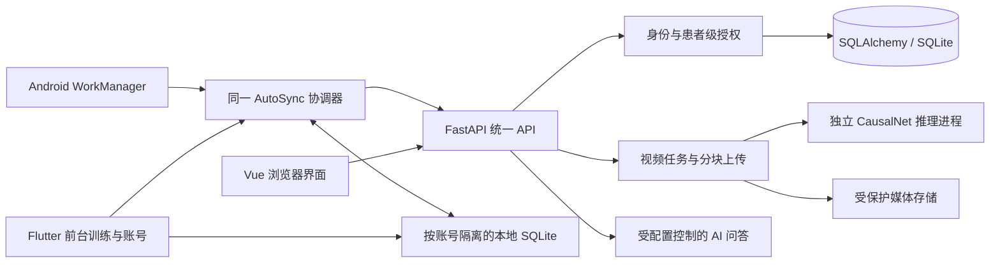

# 帕琴律动网站与双端集成技术文档

版本日期：2026 年 11 月 6 日；发布更新：2026 年 11 月 7 日
工程：PD-Rehab-Web、PianoForParkinson
用途：网站技术说明、团队整合与复现交接

> 2026-11-07：账号后端现已上线，App 最终集成版本为 0.1.64+65，保留队友新版界面和 AccountController / AccountApi / AccountSessionVault 架构。注册采用主动确认同步对话，前后台共用原生全局文件租约。正文中 11 月 6 日的本地分支记录属于实施历史；最终版本、验收和使用方式以 [上线记录](mobile-accounts-release-20261107.md) 为准。

## 1 系统概述与版本范围

帕琴律动面向帕金森康复场景，将患者档案、视频辅助评估、钢琴节奏训练、芭蕾动作训练以及随访报告组织在同一平台。Web 侧管理患者及历史结果，Flutter 侧保留本地训练与离线记录，两端通过统一 FastAPI 后端交换授权范围内的数据。

核心数据链为：确认身份与患者 → 采集键盘事件或视频 → 执行质量检查与指标计算 → 保存原始数据、来源和算法版本 → 历史回读与可比趋势分析。系统用于辅助评估与训练记录，不直接提供疾病诊断，训练曲线变化也不等于已证实的疗效。

本文以重新克隆的 Web `main@7e1c73153fc5de63a28c2def883dddb8402bd3f3`、Flutter `main@4dc63c25a0692fe2b7e747244b942502736cf66e` 及本轮本地账号集成源码为依据。Flutter 本地目标版本为 `0.1.61+62`。上述是 11 月 6 日本地实施基线；账号后端已于 11 月 7 日推送和部署，最终 App 为 0.1.64+65。网站现有入口为 [帕琴律动](https://ccqspace.site/pd-rehab/)，线上运行状态需要在发布时另行核验。

## 2 总体架构



| 层级 | 技术与职责 |
| --- | --- |
| Web 界面 | Vue 3、TypeScript、Element Plus；页面、表单、训练提示与结果展示 |
| Web 状态与导航 | Pinia、Vue Router；登录状态、患者上下文、训练任务与导航生命周期 |
| 音频与图表 | Web Audio API、ECharts；钢琴声音调度、回放和历史趋势 |
| 统一后端 | FastAPI、Pydantic；认证、参数校验、业务接口及统一错误结构 |
| 数据层 | SQLAlchemy、Alembic、SQLite；患者、评估、原始记录、版本和授权关系 |
| 视频处理 | FFmpeg/ffprobe、OpenCV、MediaPipe；解码、切片、关键点与质量检查 |
| 面部模型 | 独立 Python/PyTorch CPU 进程；严格加载 CausalNet 权重和特征预处理 |
| Flutter | Dart、SQLite、原训练引擎；本地优先存储与账号内自动同步 |
| Android 账号基础设施 | Keystore、AES-GCM、AtomicFile、WorkManager、文件锁 |
| 服务运行 | HTTPS 反向代理、Uvicorn、systemd；部署保持目标项目隔离 |

当前验证以 SQLite 为准。SQLAlchemy 保留切换其他数据库的能力，但不能据此宣称完成了 MySQL/PostgreSQL 部署与并发验证。

## 3 网站功能模块

### 3.1 工作台与患者档案

工作台提供主要业务导航、近期活动和患者概览。患者档案支持搜索、筛选、新增、编辑和资料查看。患者编号由后端分配；患者 UUID 是记录关联依据，界面编号不替代 UUID。编号分配记录避免误复用，既有编号和外键不被本轮账号集成重写。

患者详情汇总基本资料、医疗资料和近期评估。历史入口读取对应记录的结果与分析数据，不通过重新启动训练来代替查看结果。资料编辑保留版本校验，避免旧页面覆盖较新的修改。

### 3.2 评估中心

评估中心提供综合评估、手指敲击和面部表现分析入口。综合评估按子项结果组织完成状态；手指敲击在采集阶段选择左手或右手，避免两个重复入口执行同一流程。历史入口进入结果查询，未完成记录的删除与退出清理受状态校验约束。

手指视频通过手部关键点提取拇指与食指开合变化，计算适用的频率、幅度、速度和周期特征。分析保留有效帧、质量问题及算法版本；缺失数据不是零分，不够分析的录像不能生成正常结果。

面部页面直接提供打开/关闭摄像头、开始/停止录制或选择文件、候选片段确认、分析及结果展示。打开摄像头只产生预览，停止录制才得到待分析视频；无需额外的“开始检查”来创建另一套流程。可见结果受账号与患者授权控制，不额外设置等待医生查看的门槛。

### 3.3 康复训练与随访

康复训练包括钢琴与芭蕾。未选患者时允许浏览、试听和选择练习，真正开始训练时才检查患者身份并倒计时。取消、退出或网络错误必须与训练保存状态明确区分。

随访与报告包含训练日历、趋势分析、综合报告及软件端记录。日历按日期归集已完成评估和训练，不把进行中或中断任务显示为已完成。日历与当日详情卡片保持布局对齐。

趋势比较需要相同练习、关键参数、指标定义和可比算法版本。页面显示数据数量与可用指标，缺少记录时不能虚构曲线。Flutter 的原始结果单独保留来源，不伪装成由 Web 算法重算的同名指标。

### 3.4 中英文与可访问性

网站提供中文与英文切换，切换控件简写为“文/A”。语言偏好在刷新后保留，患者姓名、原始记录和用户备注不自动翻译。导航、表单、按钮、空状态和图表标签按词条切换。页面适配桌面、平板及手机；摄像头仍需要 HTTPS/localhost、安全权限和实际设备支持。

## 4 钢琴练习与计算指标

| 练习标识 | 训练任务 | 适用的专项输出 |
| --- | --- | --- |
| `GUIDED_SONG` | 分段示范、模仿、跟弹与回放 | 音符匹配、完成情况、时序误差 |
| `SINGLE_KEY_RHYTHM` | 单键响应提示 | 准确率、反应延迟、漏击 |
| `ALTERNATING_HANDS` | 左右任务映射交替 | 交替顺序与时序表现 |
| `MAPPED_SEQUENCE` | 指定按键序列 | 序列正确率与响应时间 |
| `FOLLOW_THE_BEAT` | 对齐目标节拍 | 节拍绝对误差与偏移 |
| `MEMORY_RHYTHM` | 提示后记忆复现 | 复现准确率、节奏偏差 |
| `CFT_RHYTHM_HOLD` | 提示减少后保持节奏 | 节奏稳定性与漂移 |
| `BIMANUAL_SYNC` | 同时完成双键任务 | 双键时间差、同步表现 |
| `ACCENT_GROUPING` | 识别强弱节拍分组 | 分组响应准确率 |
| `TEMPO_RAMP` | 跟随变速提示 | 分阶段时序与变速适应 |
| `HOLD_RELEASE` | 控制按下、保持与释放 | 持续时长与释放误差 |
| `BIMANUAL_OFFSET` | 双手按不同偏移响应 | 相位偏差与顺序表现 |
| `REVERSE_SEQUENCE` | 逆序复现序列 | 逆序正确率与响应时间 |
| `GO_NO_GO` | 目标响应、非目标抑制 | 命中、漏击与误响应 |

通用计算建立在真实 Cue 与原始事件上。前端记录事件时间，后端校验任务参数和事件结构，计算并保存适用指标。准确率、反应时间和节拍误差的分母与单位以各练习规则为准，不跨任务直接相加。

普通键盘和触屏无法可靠测量物理按压力度，强拍识别不输出伪造力度。按键映射也不能证明患者实际使用了某根生理手指。个人基线仅采用符合来源与质量条件的有效校准，不将程序生成事件当作真实人体校准。

## 5 芭蕾动作与姿态分析

| 标识 | 动作 |
| --- | --- |
| `BALLET_PORT_DE_BRAS` | 芭蕾手臂组合 |
| `BALLET_FIRST_POSITION` | 第一位姿态保持 |
| `BALLET_TENDU` | 伸腿点地；坐姿采用适配版本 |
| `BALLET_DEMI_PLIE` | 扶椅浅屈膝 |
| `BALLET_WEIGHT_SHIFT` | 节奏性重心转移 |

动作页面提供图片、动作选择、适用姿势及视频输入。姿态分析依据实际可见关键点计算关节角度、对称性、稳定性等适用指标，同时记录动作版本、执行方式与质量信息。说明图片不作为患者完成动作的测量证据。

本轮账号集成不修改动作、触摸、音乐引擎、训练难度或原有指标算法。

## 6 面部模型与自动选帧

### 6.1 三个阶段的职责

1. **区间定位**：在短视频中寻找面部变化的起始与结束候选。
2. **峰值定位**：在候选区间内寻找变化最明显的帧。
3. **表情识别**：将确认的关键帧交给 CausalNet 输出类别分数。

当前默认选帧是本项目的 `face-displacement-multiscale-v1` 工程基线：以 MediaPipe FaceMesh 获取面部关键点，用稳定锚点校正平移、平面旋转和尺度变化，计算归一化嘴眉位移，滤波后寻找完整区间，并从高位移平台选择峰值。它不等同于已经完整复现某篇论文的定位网络，仍保留人工确认与失败重录。

参考研究包括 [DMA-ME-Spotting](https://github.com/TJUMMG/DMA-ME-Spotting) 的多尺度定位思想，以及 [SoftNet-SpotME](https://github.com/genbing99/SoftNet-SpotME) 的离线技术对照。SoftNet 曾独立运行公开权重进行比较，不能写成当前线上默认模型，也不能据单个视频认定方法优劣。

### 6.2 CausalNet 权重和预处理

分类参考 [CausalNet](https://github.com/tony19980810/CausalNet)。已集成的工程候选为用户提供的 `s12.pth`，权重 SHA-256 为 `34b854298eca115b57aefd042f9350026359414561039ba9b0dc86970f8be973`。它是联调候选，不是通过本轮试验选出的最优数据集模型。

适配器严格恢复网络与权重，使用 `weights_only=True`、`mmap=True` 及 `load_state_dict(strict=True, assign=True)`，结构保持 `block_repeats=(3,3,7)`。对齐后的关键帧经 TV-L1 光流、光学应变和四路特征进入独立推理进程。资源清单绑定源码、权重哈希和预处理版本。

输出顺序为 `negative / positive / surprise`，即负向、正向、惊讶。三分类 softmax 是模型分数，不是校准准确率；不输出帕金森患病概率。训练裁脸的完整实现未公开，当前对齐适配尚未证明与训练裁脸完全等价，`training_contract_verified=false` 和 `clinical_eligible=false` 如实保留。

帧号采用原始视频索引及真实帧率，普通约 30 FPS 手机视频的链路已有历史工程验证；这不证明与高速微表情数据具有同等识别性能。不能插帧后声称提升了原始采样率。本轮账号任务没有重新跑真实模型精度实验。

旧 MicroFlow-DA 适配仍在仓库中，其已有 `TEMPORAL_BRANCH_DISCONNECTED` 边界不能因换账号功能而消失。可用模型以实际资源及 `/api/system/models` 状态为准。详细复现见 [CausalNet 接入](causalnet-integration.md) 和 [自动选帧](auto-face-keyframes.md)。

## 7 原始训练录像的跨端闭环

App 在独立录像授权后采集训练面部视频，训练成绩先保存本机。录像上传与成绩同步独立，录像失败不应使原训练记录丢失。原始 MP4 分块上传，父任务负责归属、状态、保留期、媒体分段和结果组织。

云端处理链为：创建父任务 → 分块上传并校验 → 完成上传 → 切分和定位 → 人工复核候选 → CausalNet 推理 → 结果回读。失败、取消、删除与迟到结果均有状态检查。删除录像清理对应媒体和分析结果，保留原始训练成绩。

Web 在“随访与报告 → 软件端记录”选择对应训练记录，可查看录像状态、片段、三帧候选与结果，也可播放和下载仍在保留期内的原始 MP4。播放器使用逐文件短期授权 Cookie，支持 Range/HEAD；下载由同一授权入口的 `?download=true` 返回附件，不暴露服务器路径或公开媒体链接。权限、绑定或移动会话撤销后需要拒绝继续访问。

## 8 账号注册、会话与患者授权

### 8.1 普通账号与工作人员分离

本轮增加普通 `PATIENT` 账号，注册仅接受用户名、密码、姓名/昵称和同步授权版本，不能指定管理员角色、患者 UUID 或已有工作人员身份。注册在事务中建立用户、患者、唯一编号和关联；用户名与既有工作人员进行大小写一致性检查。

为兼容原记录外键，普通账号复用现有用户主键表，并由新增 `mobile_accounts` 一对一关联患者。这不意味着普通账号拥有工作人员权限。请求需要同时通过移动会话检查、接口白名单和患者级对象授权。工作人员继续使用原 `/auth/login` 及原有授权规则。

普通账号不能获取患者目录、工作人员目录、任意患者档案或管理接口。自有训练、计划和视频还需验证患者、设备档案绑定和上传归属；不能只靠客户端传入的患者 ID 放行。

### 8.2 会话安全

移动访问令牌有效期 15 分钟，仅存在内存；刷新会话按 30 天有效期轮换。后端保存刷新令牌哈希和撤销状态，校验 JWT 中的会话 ID。刷新采用数据库事务与条件更新，避免同一旧令牌同时成功轮换两次。

Android 使用 Keystore 管理 AES-GCM 密钥，将刷新会话和最小身份信息加密写入 `noBackupFilesDir`，通过 AtomicFile 防止部分写入。密码、访问令牌、明文恢复码不进入持久存储。离线恢复仅允许仍未到期的已验证缓存身份，不让未登录用户绕过登录门进入训练。

注册后一次性展示恢复码，用户确认保存后进入账号工作区。改密/重置会撤销旧会话，恢复码重置后轮换。退出先使本地身份失效并隔离界面，再尝试服务端撤销；离线失败保留加密撤销补偿，联网后重试。

### 8.3 本地账号隔离

本地目录由规范化服务地址和用户 UUID 的 SHA-256 派生，格式为 `account-<64位哈希>`。每个目录分别保存训练库、同步侧库和会话相关缓存；切换账号先关闭旧控制器、同步任务和数据库，再打开新工作区。旧访客数据不自动归入新账号，也不通过登录迁移或清空旧训练库。

训练录像密文目录同样按账号增加命名空间，防止当前账号的清理任务误删其他账号合法录像。保留原有加密与旧目录兼容行为。

## 9 自动同步与一致性

### 9.1 共用同步器

前台和后台复用现有 `AutoSync`，不另造一套网络或指标算法。训练、曲目表现、舞蹈和计划先落本机，再通过授权 API 同步；视频继续使用独立录像队列，后台结构化同步不自动录制或上传视频。

前台在启动、恢复和本地记录变化等已有触发点执行同步，失败保留本地记录并重试。Android WorkManager 增加联网约束的一次性任务和最小 15 分钟周期任务；实际调度受系统省电、进程和网络影响，不承诺每 15 分钟准点执行，也不保证强制停止后继续运行。

前台存活时 Worker 调用同一协调器；无前台时以受限 headless FlutterEngine 执行结构化同步。后台不初始化音频、摄像头、训练引擎或未完成训练恢复，不对旧库进行迁移。后台只打开已存在且符合版本/完整性要求的库。

最终发布实现由前台与后台共享一个原生全局文件租约，覆盖账号会话及数据库生命周期，避免前后台同时轮换凭证或写库。不能用 Dart isolate 内布尔变量代替操作系统锁。

### 9.2 幂等与计划进度

记录按设备、来源记录 ID 和类型建立稳定身份，相同内容重传不新增，冲突内容拒绝静默覆盖。计划快照保留版本与历史，当前状态选择最高有效 `snapshot_revision`，迟到的旧版本或无版本记录不回退新进度。

`daily_progress` 区分次数和时长单位。有效验收为目标 2 次：完成第一次显示 `1/2`，完成第二次显示 `2/2`；重复同步不新增版本；再提交旧快照不回退。没有有效快照的日期显示未知，不补成 0 次或完成。

## 10 数据实体与接口

| 数据域 | 主要持久化内容 |
| --- | --- |
| 患者与编号 | 患者 UUID、显示编号、基本/医疗资料、编号分配记录 |
| 身份与授权 | 原工作人员、患者访问关系、设备档案绑定、审计日志 |
| 移动账号新增 | `mobile_accounts`、`mobile_sessions`；关联、恢复哈希、刷新哈希、到期与撤销 |
| 评估 | 会话、媒体、手指与面部结果、质量信息及模型/算法版本 |
| Web 训练 | 钢琴 Cue/原始事件/指标、曲目分段记录、姿态结果和个人基线 |
| 跨端同步 | 不可变来源载荷、版本快照、增量游标及历史 |
| 训练录像 | 父任务、文件分块、媒体分段、复核、推理结果、取消/删除状态 |

以下路径均相对于 `/api`，不把本地电脑 `127.0.0.1` 误认为服务器或手机自身的同一服务。

| 功能 | 方法与路径 |
| --- | --- |
| 工作人员登录/身份 | `POST /auth/login`、`GET /auth/me` |
| 移动注册/登录 | `POST /mobile/auth/register`、`POST /mobile/auth/login` |
| 刷新/退出 | `POST /mobile/auth/refresh`、`POST /mobile/auth/logout` |
| 自有身份/改密/重置 | `GET /mobile/auth/me`、`POST /mobile/auth/change-password`、`POST /mobile/auth/reset-password` |
| 设备绑定 | `POST /integration/v1/bindings` |
| 来源记录同步与读取 | `POST /integration/v1/records`、`GET /integration/v1/records` |
| 当前计划/增量变化 | `GET /integration/v1/plans`、`GET /integration/v1/changes` |
| Web 侧授权历史 | `GET /integration/v1/patient-data` |
| 短面部视频任务 | `/integration/v1/face/jobs` 及候选/复核/回读子接口 |
| 训练录像父任务 | `/integration/v1/face/recordings` 及上传/复核/取消/删除子接口 |
| 原始视频播放/下载 | `/integration/v1/face/recordings/{id}/files/{file_id}/playback` |
| AI 知识问答 | `POST /integration/v1/expert/chat` |
| 健康与模型状态 | `GET /system/health`、`GET /system/models` |

具体字段以对应源码生成的 OpenAPI 为准。接口使用统一错误对象，不把网络失败视作正常空列表。公开健康接口不返回密钥，模型缺失不会以随机结果冒充成功。

## 11 安装与运行条件

### 11.1 Web 本地启动

建议使用 Python 3.11 和支持当前 Vite 的 Node.js（README 要求至少 22.12）。使用独立数据库、上传目录和测试账号；生产配置、数据库和权重不提交 Git。

```powershell
git clone https://github.com/WuChangqing1/PD-Rehab-Web.git
cd PD-Rehab-Web
py -3.11 -m venv .venv
.\.venv\Scripts\Activate.ps1
python -m pip install -r backend/requirements.txt
Copy-Item .env.example .env
# 编辑 .env：独立 JWT_SECRET、初始化账号、数据库与存储路径
cd backend
python -m alembic upgrade head
python -m uvicorn app.main:app --host 127.0.0.1 --port 8000
```

另一终端：

```powershell
npm --prefix frontend ci
npm --prefix frontend run dev -- --host 127.0.0.1 --port 5173
```

已有 `.env` 不覆盖。修改初始化管理员配置不会重置已有账号密码。已有数据库必须先确认版本、备份和迁移演练。本轮新增迁移为 `m9b1c3d5e7f9 → n0c2d4e6f8a0`，已于 11 月 7 日应用到生产，原业务数据一致性通过核对。

### 11.2 Flutter 与外部资源

Flutter 仓库为 [PianoForParkinson](https://github.com/CapriChris/PianoForParkinson)。本轮使用 Flutter 3.47.7 / Dart 3.13.5 编译验证；需要 Android SDK、JDK 和仓库要求的资源。大视频、模型和私有资源不因源码存在而自动具备，需按资源清单补齐。

```powershell
flutter pub get
flutter analyze
flutter test
flutter build apk --debug --target-platform android-arm64
```

新账号 API 需使用本轮后端源码，线上后端现已提供新注册功能；新接口需配合 0.1.64+65 App 使用。交付 QA 包采用独立 `.validation` 包名，避免覆盖既有 App；不得把“成功安装”视作所有真机流程已验收。

CausalNet 另需模型目录、清单、匹配解释器及真实权重；训练录像需 FFmpeg/ffprobe。摄像头需要物理设备、用户授权与安全上下文，电脑外网服务地址不等于手机本机 `localhost`。

AI 问答由服务端配置兼容 Chat Completions 的供应商地址、模型名和密钥。Windows 本机的 `127.0.0.1:18091/v1` 不能由远端服务器直接访问；需要另行配置明确授权的可达通道，不能在手机或前端硬编码密钥。

## 12 验证、交付与使用边界

本轮账号验证使用临时 SQLite、回环 HTTPS、自建短期测试 CA 和自动生成测试账号，未向生产写入测试患者或影像。回归、迁移和实际双端结果见同轮测试报告；不能将旧文档中的测试数作为本轮结果。

实测覆盖注册两个独立身份、跨患者拒绝、账号目录隔离、恢复登录、稳定绑定、计划 `2/2`、重复同步不新增、退出旧令牌失效、恢复码轮换和改密。静态分析、Flutter 回归与 APK 签名检查作为独立检查项。

仍需真机检查 Android Keystore 重启恢复、实际 WorkManager 调度、断网/杀进程/切账号、物理摄像头与后台限制。模拟 MethodChannel 和编译通过不能代替这些设备证据。模型论文准确率、跨人群性能和临床效用也不在本轮账号联调的结论范围内。

正式上线前需要单独批准：数据库迁移、服务端代码切换、目标服务重启及新 App 对接。应先在隔离环境测试并准备回滚；不得直接将旧数据库备份覆盖上线后新写入。11 月 6 日本地交付未执行这些操作；11 月 7 日已在用户批准后执行，见上线记录。

## 13 团队整合建议与源码入口

| 方向 | 主要位置 |
| --- | --- |
| Web 页面与业务组件 | `frontend/src/pages`、`frontend/src/components` |
| Vue 路由/语言/请求 | `frontend/src/router`、`frontend/src/i18n`、`frontend/src/api` |
| Web 认证与跨端 API | `backend/app/api/mobile_auth.py`、`integration.py`、`face_recordings.py` |
| 患者级授权 | `backend/app/api/deps.py`、`backend/app/services/integration_access.py` |
| 数据模型/迁移 | `backend/app/db/models`、`backend/alembic/versions` |
| 面部适配 | `backend/app/ml/micro_expression` |
| Flutter 账号页面/会话 | `lib/accounts` |
| 原有训练与同步 | `lib/app`、`lib/integration/auto_sync.dart` |
| Android 安全与后台 | `AccountVault.kt`、`AccountSyncWorker.kt`、`CaptureVault.kt` |

算法同学交付新模型时，需要同时提供源码版本、权重哈希、输入帧/通道约定、预处理、输出类别、依赖和有效测试样例。网站适配应保留来源与版本，不将未经验证的分数直接加入历史趋势。

App 同学验收顺序建议为：新后端隔离启动 → 注册并保存恢复码 → 同账号重启恢复 → 完成两次计划训练 → Web 核对 `1/2 → 2/2` → 重复同步检查无新增 → 切换账号验证隔离 → 断网与后台真机验收 → 独立授权录像与结果闭环。发布须在两端确认后单独执行。
